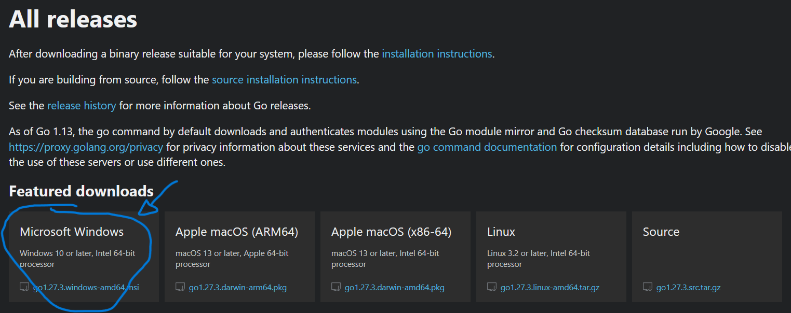

# go language tutorial
made using this [youtube video](https://www.youtube.com/watch?v=8uiZC0l4Ajw)
@NOTE: currently at 26:40

standard library docs are [here](https://pkg.go.dev/std)

## installation
  1. install git from [here](https://gitforwindows.org/) 
  2. open terminal and `cd` to your chosen directory
      - i recommend `C:\workspace\go` that way you stay organized 
      - use `cd` to change directory
      - use `mkdir` to make directories 
  3. execute command `git clone https://github.com/phil-stein/go_tutorial` 
  4. `cd go_tutorial` to go inside tutorial folder
  5. go to [go-website](https://go.dev/dl/)

  6. install it with the .msi installer
  7. close and reopen terminal
  8. go to terminal and copy paste command `go get -v -u github.com/gen2brain/raylib-go/raylib`


## start a project

  1. open terminal 
  2. `cd` to directory you wanna start a project in 
  3. `go mod init <name>` pick name as whatever you want, your application will later be called this
      1. alternatively you can `mkdir` to make directories directly in the terminal
  4. make a new file call it `main.go`
  ```go
  package main

  import "fmt"

  func main(){
    fmt.Println( "Hello World :)" )
  }
  ```
  5. make a new file call it `build.bat`
  ```batch
  @echo off

  go run .
  ```
  6. in terminal call `build` to run program

## todo
  - [X] add simple read write terminal input in place 04
    - answer questions get points
    - enter name and age
  - [X] 08_game_01, make simple game using raylib
    - falling boxes, move box at bottom to collect -> get highscore
    - simple platformer with no objective
    - answer given questions get points -> get highscore
  - [X] strings, runes, bytes
  - [X] structs and interfaces
  - [ ] pointers
  - [ ] goroutines
  - [ ] channels
  - [ ] generics

